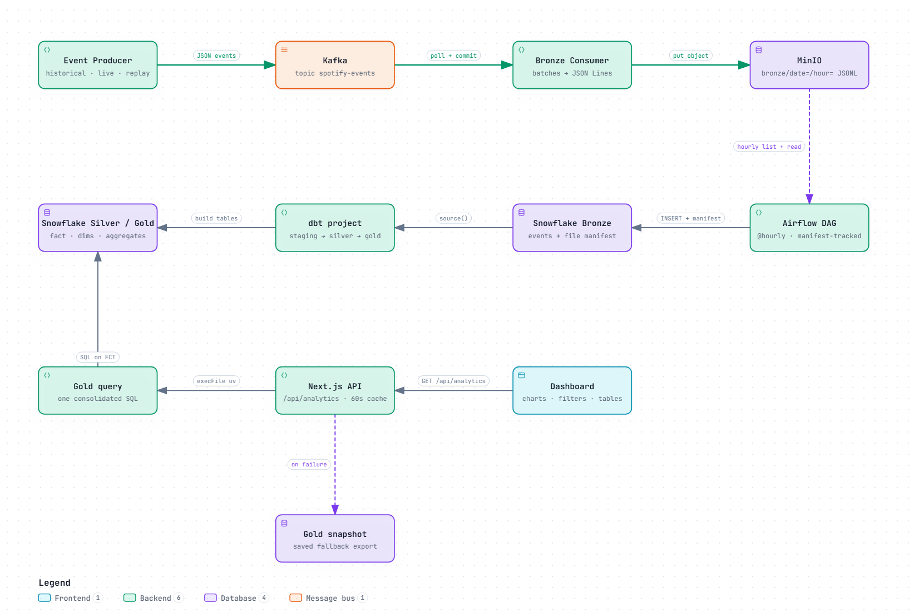
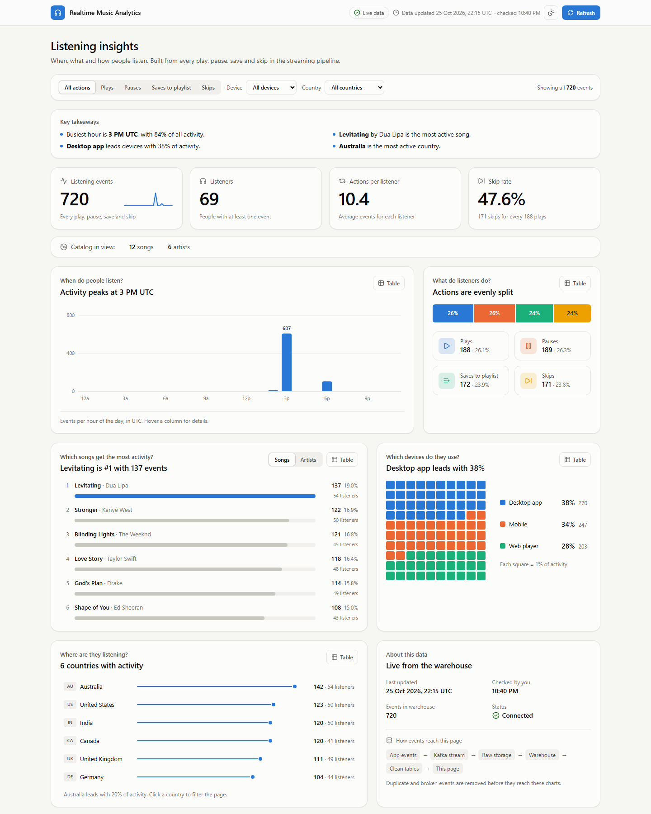
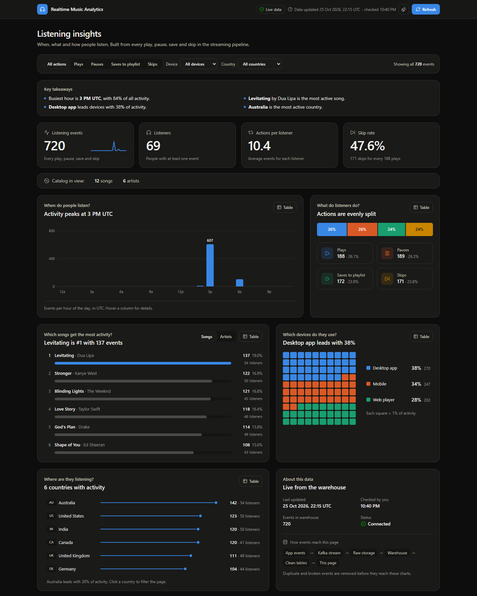

# Music Analytics Pipeline

Every time someone presses play, pauses a track, skips a song or saves it to a playlist, a tiny signal is created. On its own it means nothing. Millions of them together answer real questions: *when do people listen, what do they love, what do they skip, and where are they?*

This project follows one of those signals from the moment it is created to the moment it becomes a number on a dashboard. Along the way it passes through a message stream, an object-storage lake, an orchestrator, a cloud warehouse and a layer of data-quality checks. Each stop exists because of a specific problem that would otherwise lose, duplicate or corrupt the data.



---

## 1. A listen is born

A Python producer plays the role of a music app. It invents listeners, songs and artists, then emits listening events: `play`, `pause`, `skip` and `add_to_playlist`, each tagged with a device and a country.

The producer can tell three kinds of stories:

- **Live**: a steady trickle of events, like a real app on a normal day.
- **Historical**: a burst of past events spread over weeks, used to backfill the warehouse.
- **Replay**: the same small set of events every time, used to prove that sending something twice never counts it twice.

Songs and listeners get **deterministic IDs** (UUIDv5), so "Levitating by Dua Lipa" is the same song no matter how many times the producer restarts. Without that, every restart would create a new copy of every song in the warehouse.

## 2. Into the stream

Events are published to a **Kafka** topic with `acks=all` and retries, which guarantees that each event arrives *at least once*. The phrase "at least once" carries a trade-off the rest of the pipeline has to deal with: an event can occasionally arrive twice, but it is never silently lost.

## 3. Landing safely in the lake

A consumer reads the stream in batches and writes each batch to **MinIO** (S3-compatible object storage) as a JSON Lines file, partitioned by date and hour:

```
bronze/date=2026-10-20/hour=15/spotify_events_2026-10-20T15-04-12_9f3a1c2e.json
```

The consumer moves its Kafka position forward **only after the file is safely stored**. If it crashes halfway, it simply re-reads the batch on restart. Each file name also carries a random suffix, so two batches written in the same second can never overwrite each other.

This raw landing zone is the **Bronze** layer: an untouched, append-only record of everything that happened.

## 4. The hourly pickup

Every hour an **Apache Airflow** DAG walks through the lake and loads new files into **Snowflake**.

The difficult part is remembering what has already been loaded. A **file manifest** table records every file by name, ETag and size, along with its status (`PROCESSING`, `SUCCESS` or `FAILED`):

- A file that loaded successfully is skipped next time.
- A file that was rewritten, or that failed halfway, is picked up again.
- A file's rows and its `SUCCESS` mark are committed in one transaction, so a file is either fully in the warehouse or not there at all.

The result: running the DAG once or a hundred times produces the same Bronze table.

## 5. Becoming trustworthy

Raw data is honest but messy. It contains repeats from at-least-once delivery, and potentially malformed or conflicting records. **dbt** turns it into something people can rely on, in three layers:

| Layer | What happens | Why it matters |
|---|---|---|
| **Staging** | Every row is cleaned and checked against seven rules: valid ID, parseable timestamp, known action, known device, known country, required fields present, and no conflicting copies of the same event. | Problems are flagged, not hidden. Nothing is thrown away yet. |
| **Silver** | Only rows that pass every rule survive, collapsed to exactly one row per `event_id`. Failing rows go to a **quarantine** view with every reason attached. | Duplicates disappear here, and each excluded row can still be explained. |
| **Gold** | A star schema: one fact table of listening events, dimensions for songs, users and dates, and ready-made aggregates for rankings, devices and countries. | Analysts get fast, simple tables with no risk of double counting. |

Two modelling decisions shape Gold:

- **Device and country live on the fact, not on the user.** One listener can switch from phone to laptop, or appear in several countries, within an hour, so these describe the moment rather than the person.
- **The calendar grows with the data.** The date dimension spans from the first to the last event instead of a fixed month, so a historical backfill never falls off the calendar.

Over a hundred dbt tests guard these promises: uniqueness, non-null keys, valid relationships, and reconciliation checks proving that staging, Silver and Gold agree on row counts.

## 6. Telling the story

The last stop is a **Next.js** dashboard that turns Gold tables into answers. Each card asks a plain question and answers it in one line, and each one uses a chart suited to the question:

- **When do people listen?** Hour-by-hour column chart.
- **What do listeners do?** A single 100% bar splitting plays, pauses, saves and skips.
- **Which songs and artists lead?** Ranked bars, with the leader highlighted.
- **Which devices?** A waffle grid where every square is 1% of activity.
- **Where are they listening?** A lollipop chart; clicking a country filters the whole page.

Every chart can switch to a plain table. The colour palette is checked for colour-blind safety in both light and dark themes. If the warehouse is unreachable, the page says so clearly and falls back to a saved Gold snapshot instead of showing a blank screen.





Behind the page, one API route runs a single consolidated SQL query against Gold and caches the result for 60 seconds. Filter values are checked against an allow-list before they reach the warehouse.

## 7. Shipping changes safely

Every change to the pipeline goes through the same gate. On each push and pull request, **CI** runs three jobs in parallel. The first runs the producer, consumer and DAG tests offline. The second parses the whole dbt project, checking every model, reference and data test. The third lints, type-checks and builds the dashboard. None of them needs a warehouse or a secret.

When a change reaches `main` and CI is green, **CD** deploys the warehouse. A protected `production` environment runs `dbt build` against Snowflake, which rebuilds Silver and Gold and runs the data tests in dependency order, so a failing test stops everything downstream of it. The deploy checks out exactly the commit CI tested, never runs two at once, and leaves a results summary and the dbt artifacts on the run.

---

## Why it is built this way

| Decision | Problem it solves |
|---|---|
| Kafka between the app and storage | The app never waits on storage; bursts are absorbed by the stream. |
| Commit offsets only after upload | A crash replays data instead of losing it. |
| Append-only Bronze that keeps duplicates | The raw record stays complete and auditable; cleaning happens later, in the open. |
| File manifest with ETag + size | Hourly loads are safe to rerun and recover from partial failures. |
| Quarantine instead of delete | Every excluded row can be explained and fixed at the source. |
| No joins in the fact table | The fact can never fan out and inflate counts. |
| Snapshot fallback in the dashboard | The story stays readable even when the warehouse is down. |

This is a **micro-batch** pipeline: events stream continuously, but the warehouse refreshes on the hourly Airflow schedule plus dbt run time. Kafka and MinIO make each event durable within seconds; the dashboard reflects the latest warehouse load.

## Built with

| Stage | Technology |
|---|---|
| Event generation | Python 3.13 |
| Streaming | Apache Kafka (Confluent 7.4), ZooKeeper, Kafdrop |
| Lake storage | MinIO (S3-compatible) |
| Orchestration | Apache Airflow 2.9 in Docker Compose |
| Warehouse | Snowflake, with RSA key-pair authentication |
| Transformation and testing | dbt-core with dbt-snowflake |
| Dashboard | Next.js 16, React 19, TypeScript, Tailwind CSS |
| CI/CD | GitHub Actions: offline pytest, dbt parse, dashboard lint/typecheck/build; `dbt build` on Snowflake after CI passes on `main` |

## Where things live

```
stimulator/      the "music app": synthetic event producer
consumer/        Kafka -> MinIO Bronze landing
docker/          Kafka, MinIO and Airflow services, plus the hourly DAG
spotify_dbt/     staging, Silver, quarantine and Gold models with data tests
dashboard/       Next.js dashboard and its Gold query
tests/           producer, consumer and manifest tests
image/           architecture diagram and dashboard screenshots
```

Credentials, private keys and `.env` files never enter version control; each component ships only an `.env.example` listing what it needs.
