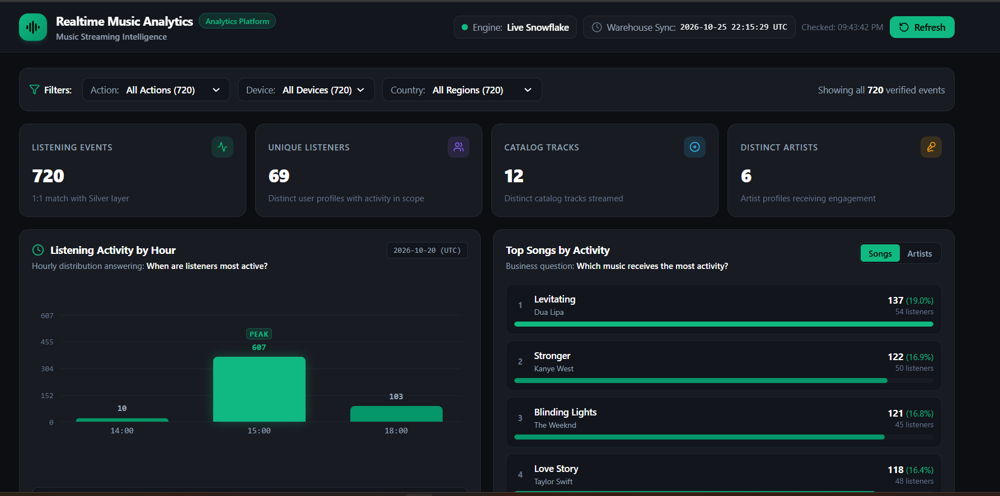
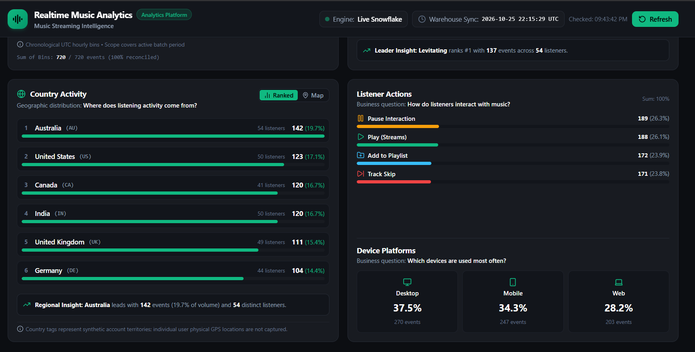

# Music Analytics Data Pipeline

An end-to-end data engineering project demonstrating a batch lakehouse architecture on local infrastructure. Synthetic Spotify-style listening events flow from a Python producer through Kafka, land in MinIO object storage, are orchestrated into Snowflake by Apache Airflow, transformed through Bronze → Silver → Gold layers by dbt, and surfaced in a custom Next.js analytics dashboard.

> **Note:** This is a batch pipeline. The producer emits events near-continuously; the warehouse updates on the Airflow DAG schedule (~hourly) plus dbt transformation time. The dashboard is not a real-time stream.

---

## Architecture


---

## Data Flow

```
Python Producer (stimulator/datagenerator.py)
    │  Kafka topic: spotify-events  (at-least-once, acks=all)
    ▼
Kafka Consumer (consumer/kafka_to_minio.py)
    │  Batches events → NDJSON files uploaded to MinIO
    ▼
MinIO Object Storage
    │  Prefix: bronze/date=YYYY-MM-DD/hour=HH/
    │  Airflow DAG (@hourly) — file-manifest idempotency
    ▼
Snowflake Bronze  (SPOTIFY_EVENTS_BRONZE + BRONZE_FILE_MANIFEST)
    │  dbt: staging → silver → gold
    ▼
Snowflake Silver  (silver_spotify_events — deduplicated, quarantine-filtered)
    ▼
Snowflake Gold    (star schema: dims + facts + aggregates)
    │  Next.js API route — single CTE query, 60 s server-side cache
    ▼
Next.js Dashboard  (http://localhost:3000)
```

---

## Technology Stack

| Layer | Technology |
|---|---|
| Event Generation | Python 3.13 · Faker |
| Message Bus | Apache Kafka (Confluent 7.4) · ZooKeeper · Kafdrop |
| Object Storage | MinIO (S3-compatible) |
| Orchestration | Apache Airflow 2.9 (Dockerised) |
| Data Warehouse | Snowflake |
| Transformation | dbt-core 1.12 · dbt-snowflake |
| Dashboard | Next.js 15 · React · TypeScript |
| Package Manager | uv |
| CI | GitHub Actions |

---

## Dashboard

The dashboard queries the Snowflake Gold layer and supports interactive filtering by event type, device, and country.

**Analytical datasets exposed:**

| Dataset | Description |
|---|---|
| KPI summary | Total events, unique users, unique songs, unique artists |
| Hourly timeline | Event volume and active users by hour |
| Top songs | Play/event counts and distinct listener reach per track |
| Top artists | Event volume, distinct songs, and distinct listeners per artist |
| Event distribution | Breakdown by event type (play, pause, skip, add\_to\_playlist) |
| Device distribution | Desktop / Mobile / Web share |
| Country distribution | Events and unique users per country |

The dashboard falls back gracefully to a verified Gold snapshot if the Snowflake connection is unavailable.





---

## Repository Structure

```
Realtimepipeline/
├── stimulator/               # Python event producer (live / historical / replay modes)
│   ├── datagenerator.py
│   └── .env.example
├── consumer/                 # Kafka → MinIO consumer
│   ├── kafka_to_minio.py
│   └── .env.example
├── docker/                   # Docker Compose (Kafka, ZooKeeper, Kafdrop, MinIO, Airflow)
│   ├── docker-compose.yml
│   ├── .env.example
│   └── dags/
│       ├── minio_to_kafka.py # Airflow DAG: MinIO → Snowflake Bronze
│       └── .env.example
├── spotify_dbt/              # dbt project
│   ├── models/
│   │   ├── staging/          # Raw Bronze normalisation views
│   │   ├── silver/           # Deduplicated canonical events + quarantine
│   │   └── gold/
│   │       ├── dimensions/   # dim_songs, dim_users, dim_date
│   │       ├── facts/        # fct_listening_events
│   │       └── aggregates/   # agg_daily_activity, agg_song_rankings,
│   │                         # agg_artist_rankings, agg_country_activity,
│   │                         # agg_device_distribution
│   └── tests/                # dbt data-quality tests
├── dashboard/                # Next.js analytics dashboard
│   ├── src/
│   │   ├── app/              # Next.js App Router pages and API routes
│   │   ├── components/       # React chart and UI components
│   │   ├── lib/
│   │   │   ├── data.ts       # Server-side data fetching with 60 s cache
│   │   │   └── query_gold_api.py  # Python → Snowflake Gold query bridge
│   │   └── data/             # Verified Gold snapshot (fallback)
│   └── .env.example
├── src/realtimepipeline/     # Shared utilities (baseline manifest helper)
├── tests/                    # Python unit and integration tests
├── image/                    # Architecture diagram and dashboard screenshots
├── secrets/                  # RSA key pair — NEVER committed (gitignored)
├── .github/workflows/ci.yml  # GitHub Actions CI
└── pyproject.toml            # Python project and dependency manifest (uv)
```

---

## Configuration and Environment Variables

Each component reads credentials from a local `.env` file. Copy the relevant `.env.example` to `.env` and fill in your values. **Never commit `.env` files or key material.**

### Producer — `stimulator/.env`

| Variable | Description |
|---|---|
| `KAFKA_BOOTSTRAP_SERVERS` | Kafka broker address (e.g. `localhost:29092`) |
| `KAFKA_TOPIC` | Target topic name |
| `PRODUCER_MODE` | `live` \| `historical` \| `replay` |
| `USER_COUNT` | Number of synthetic users |
| `EVENT_INTERVAL_SECONDS` | Delay between live events |

### Consumer — `consumer/.env`

| Variable | Description |
|---|---|
| `MINIO_ENDPOINT` | MinIO S3-compatible endpoint URL |
| `MINIO_ACCESS_KEY` | MinIO access key |
| `MINIO_SECRET_KEY` | MinIO secret key |
| `MINIO_BUCKET` | Target bucket name |
| `KAFKA_TOPIC` | Source topic name |
| `KAFKA_BOOTSTRAP_SERVER` | Kafka broker address |
| `KAFKA_GROUP_ID` | Consumer group ID |
| `BATCH_SIZE` | Events per NDJSON file |

### Docker services — `docker/.env`

| Variable | Description |
|---|---|
| `MINIO_ROOT_USER` | MinIO root username |
| `MINIO_ROOT_PASSWORD` | MinIO root password |
| `POSTGRES_USER` | Airflow metadata DB user |
| `POSTGRES_PASSWORD` | Airflow metadata DB password |
| `AIRFLOW_ADMIN_USER` | Airflow web UI admin username |
| `AIRFLOW_ADMIN_PASSWORD` | Airflow web UI admin password |

### Airflow DAG — `docker/dags/.env`

| Variable | Description |
|---|---|
| `SNOWFLAKE_USER` | Snowflake login user |
| `SNOWFLAKE_ACCOUNT` | Snowflake account identifier |
| `SNOWFLAKE_PRIVATE_KEY_PATH` | Path to RSA `.p8` key file |
| `SNOWFLAKE_WAREHOUSE` | Virtual warehouse name |
| `SNOWFLAKE_DATABASE` | Target database |
| `SNOWFLAKE_SCHEMA` | Target schema |
| `MINIO_ENDPOINT` | MinIO endpoint (container-internal) |
| `MINIO_ACCESS_KEY` | MinIO access key |
| `MINIO_SECRET_KEY` | MinIO secret key |

### Dashboard — `dashboard/.env`

| Variable | Description |
|---|---|
| `SNOWFLAKE_ACCOUNT` | Snowflake account identifier |
| `SNOWFLAKE_USER` | Snowflake login user |
| `SNOWFLAKE_PRIVATE_KEY_PATH` | Path to RSA `.p8` key file |
| `SNOWFLAKE_WAREHOUSE` | Virtual warehouse name |
| `SNOWFLAKE_DATABASE` | Target database |
| `SNOWFLAKE_SCHEMA` | Schema to query (`GOLD`) |
| `SNOWFLAKE_ROLE` | Snowflake role (optional) |

> Snowflake authentication uses RSA key-pair authentication. Place your `.p8` private key in `secrets/rsa_key.p8`. The `secrets/` directory is gitignored and must never be committed.

---

## Continuous Integration

GitHub Actions CI (`.github/workflows/ci.yml`) runs on every push and pull request:

| Job | What runs | Credentials required |
|---|---|---|
| Producer unit tests | Offline Kafka/MinIO mocks | None |
| DAG configuration tests | DAG structure + error sanitisation | None |
| dbt parse | YAML + SQL syntax validation | None (dummy env vars) |
| Dashboard build | ESLint + Next.js production build | None (dummy env vars) |

Integration tests (Snowflake + live MinIO) are run locally only.

---

## Security Note

- All `.env` files, RSA private keys (`.p8`), and the `secrets/` directory are excluded from version control via `.gitignore`.
- **Configure your own credentials** before running. Do not reuse example values in production.
- If you fork this repository, generate a new RSA key pair for Snowflake authentication. The `secrets/` directory should never appear in `git status` output.
- See each component's `.env.example` for the full list of required variables.

